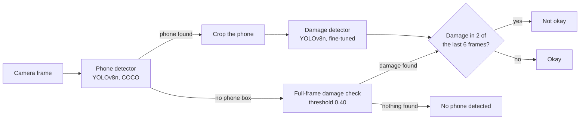

<div align="center">

# 📱 Phone damage check

**Point your camera at a phone and see in real time whether it looks okay or damaged.**
Runs entirely in your browser. No video is uploaded.

[](https://15sarvagya.github.io/phone-damage-check/)


[](https://15sarvagya.github.io/phone-damage-check/)

*Click the screenshot to open the live app (Chrome or Edge, allow camera access).*

</div>

> [!NOTE]
> This is a learning project, not a certified inspection tool. See the limitations below.

## 🔍 How it works



- The phone detector runs every 4th frame, and its last box is reused in between.
- The verdict is smoothed over recent frames so it does not flicker.
- Both models are exported to ONNX and run with ONNX Runtime Web, on WebGPU when available and WebAssembly otherwise.

## 📊 Results


Held-out test split of 189 images (149 damaged, 40 undamaged). Model: YOLOv8n, 50 epochs, 640 px, seed 42.

| Class | Precision | Recall | mAP50 |
|---|---|---|---|
| all | 0.776 | 0.556 | 0.635 |
| crack | 0.755 | 0.471 | 0.559 |
| scratch | 0.774 | 0.635 | 0.667 |
| display_defect | 0.798 | 0.561 | 0.681 |

At the 0.25 verdict threshold, the app flagged 137 of 149 damaged phones and passed 35 of 40 undamaged ones. With only 40 undamaged images, the second number is rough. The ONNX export scored 0.659 mAP50 on the same split when evaluated one image at a time.

## ⚡ Speed

| Setup | Time per frame |
|---|---|
| Chrome with WebGPU (my laptop) | about 66 to 77 ms (13 to 15 frames per second) |
| Earlier version, both models on the CPU | about 750 to 800 ms |

Speed depends on the device and browser. I have not tested on phones yet.

<details>
<summary><b>🗂️ Data and cleaning (click to expand)</b></summary>

<br>

Public datasets from Roboflow Universe only.

- **Mobile Damage Diagnosis** turned out to contain the same 1,901 images as **Mobile phone detection (Sengital)** (checked with perceptual hashing), so I dropped it to avoid double counting.
- **Crackedscreen** provided undamaged phones. Its images labelled "broken phone" were dropped, because they would have become wrong "no damage" examples.
- Labels were merged into 3 classes: `crack`, `scratch`, `display_defect`.
- 1,974 images became 1,884 after near-duplicate removal. The split is 1,507 train, 188 validation, 189 test, with a fixed seed. The exact assignment is in `splits.json`.

Licenses and sources: see each dataset's page on Roboflow Universe. TODO: add the exact license line for each dataset here.

</details>

<details>
<summary><b>⚠️ Limitations (click to expand)</b></summary>

<br>

- Crack recall is the weak point (0.47). The model misses small and faint cracks.
- Most training images are product-style photos, and some are mosaic-augmented by the original dataset authors. Dim light and cluttered backgrounds will do worse than the test numbers suggest.
- I tried 960 px training. It raised mAP slightly on an earlier split but did not improve the OK / NOT OK verdict, so I shipped the faster 640 model. That comparison was not rerun on the final split.
- The page checks one phone at a time.

</details>

<details>
<summary><b>💻 Run it locally (click to expand)</b></summary>

<br>

```
python -m http.server 8000
```

Then open http://localhost:8000 in Chrome. The page needs the `models/` folder next to `index.html`.

</details>

<details>
<summary><b>📁 Files (click to expand)</b></summary>

<br>

| File | What it is |
|---|---|
| `index.html` | The app |
| `models/damage_640.onnx` | Damage detector (fine-tuned) |
| `models/phone_coco_640.onnx` | Pretrained COCO phone detector |
| `splits.json` | Train / validation / test assignment |
| `docs/` | Screenshot and results chart used in this README |

</details>
